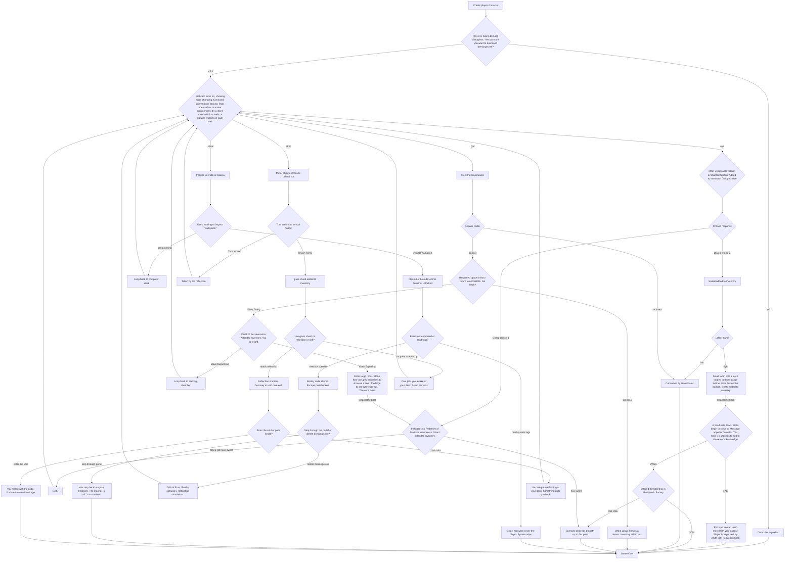

# Between the Interpolated
An interactive, browser-based story in HTML, CSS, and JavaScript that features images, branching choices, and multiple distinct endings. 

## Team Members and Roles

### Mike Maggio

* JavaScript classes
* JSON integration
* Inventory system
* Keyboard input recognition
* User text input
* User text validation
  
### Javon Speller

* CSS
* Story & Dialogue Progession
* Dynamic Scene Visuals
* Conditional Story Branching
* Player Status Tracking
* Interactive Image Hover

## Application Overview

This is an interactive Dark Fantasy story about a curious hacker that dove a bit too deep into a system they didn't understand. Players will navigate mind bending peril as they search for a way out... or choose to continue their descent, sacrificing everything just to learn a little bit more.

### Player Character Stats

    * Name: Player chosen name.
    * Gender: Player chosen gender.
    * History: Keeps a detailed record of all rooms visited and choices made my player.
    * Inventory: Keeps track of the player's items.
    * Number of Shards Collected: Keeps track of the number of shards in the player's inventory.
    * Paths Explored: Keeps track of which paths the player has been down.
    * Crackedness: As the player delves deeper into the dungeon, they will become more adept at surviving the systems working against them.

## Flowchart

